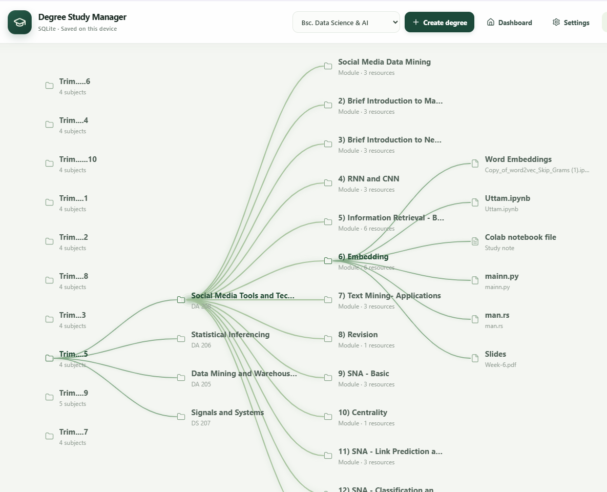

# Degree Study Manager - Full Local Version

## Download for Windows

check the [Releases page](https://github.com/uttam1233/Advanced_Degree_Pkg_Manager_System/releases).

## Run as a Windows desktop app

The desktop app opens its bundled UI directly and reads and writes its SQLite
database with the native Rust desktop process over private Tauri IPC. Startup
loads a cached metadata index instead of transferring every attachment,
rich-text body, and notebook cell. Full note/file contents are read on demand
when opened, while backups still include all saved data.

Existing databases
build this index once on the first launch after the update; later launches reuse
it. The app does not start a Node server, open a localhost listener, show a
PowerShell console, reserve a port, or require `npm run dev` or `npm start`.
The browser version continues to use its local HTTP server.
The standard PDF reader includes selectable text, document search, page
thumbnails and outline navigation, page/zoom controls, rotation, and fullscreen.
The flipbook remains available as a separate PDF viewing option.
Notebook execution and the practice terminal start their bundled workspace
helper only when those features are used.

To build the Windows installer:

1. Install Node.js 22 or newer, Rust, and the Microsoft C++ Build Tools with the
   MSVC build tools and Windows SDK.
2. Run `npm install`.
3. Run `npm run desktop:build`.
4. Open the generated installer under `src-tauri/target/release/bundle/nsis/`.

The installed app keeps its SQLite database and practice workspaces under
`%LOCALAPPDATA%\DegreeStudyManager`, just like the local web version. The desktop
app bundles its local runtime; features that use external tools still need their
usual Windows installations: Python with Jupyter for notebooks, and the
appropriate compiler or runtime for running practice files. Runtime diagnostics
are written to `%LOCALAPPDATA%\DegreeStudyManager\desktop-runtime.log`.
The Windows installer uses Restart Manager to close an existing app backend
that is locking the SQLite native module before replacing desktop files. If
Windows still reports a file-in-use error, abort the install, close Degree
Study Manager, and run the installer again.

The dashboard's **Storage usage** chart counts the UTF-8 size of the selected
degree's saved SQLite records and breaks it down by semester. Counts include
the saved data for attachments and notebooks; shared database overhead and
separate practice-workspace copies are excluded. The standard PDF viewer uses
the bundled PDF.js renderer to keep pages and the surrounding viewing area pure
white, with page navigation and zoom controls. **Open with…** saves the
attachment to a temporary file and displays the Windows app chooser, where you
can select an installed PDF reader or other application. Windows opens the file
in the app you select; canceling the chooser leaves it unopened.
The standard viewer also supports selectable text, search, thumbnails and
outline navigation, single- or two-page layouts, keyboard page navigation,
clickable web links, zoom steps of 5%, rotation, fullscreen, and printing. It
loads PDFs directly through PDF.js, renders only pages near the viewport, caps
page bitmap resolution, and keeps a bounded text cache to reduce peak memory
use on large documents.

For desktop development, use `npm run desktop:dev`. To keep using the browser
version, use the web instructions below.

## Run the web version

1. Install Node.js 20.19 or newer.
2. Open a terminal in this folder.
3. Run `npm install`.
4. Run `npm run dev`.
5. Open the address printed by Vite, usually `http://localhost:5173`.
6. Keep the development server running while using the app.

## Important

- Study data, uploaded files, and images inside notes are stored in a local SQLite database under the operating system's application data directory (on Windows, `%LOCALAPPDATA%\DegreeStudyManager\degree-study-manager.sqlite`).
- The SQLite database is stored on this computer and persists across browser and app restarts. It is not cloud-synced or shared across computers. Records remain until you delete them in the app or remove the database file.
- Existing browser-stored data is migrated to SQLite automatically when the app first connects to its database.
- To migrate data from an older browser session, open the development app at the same browser origin (same protocol, host, and port) where that data was stored. Browsers keep storage separate for different URLs.
- To run the production build locally, run `npm run build` and then `npm start`; the local server opens at `http://localhost:3001`.
- Use **Backup** to export the data as JSON and keep a separate copy in case the database file or computer is lost.
- Any file up to 100 MB can be attached to a syllabus item, including source code and Jupyter `.ipynb` notebooks. PDFs and images open in the in-app viewer; common text/code files up to 2 MB can be previewed there. Opening an uploaded `.ipynb` imports its v3/v4 cells and saved outputs into the editable, executable notebook; saving converts it into a regular in-app notebook.
- Imported Markdown cells render automatically. The renderer supports GitHub-style Markdown (tables, lists, links and fenced code), sanitized notebook HTML, math, inline data images, and Jupyter cell attachments. It accepts line-wrapped image links/base64 content commonly found in exported notebooks. The notebook fills the app window, mounts only nearby cells, and updates measured row heights incrementally while scrolling. Editor keystrokes stay local until execution or save, and very large text/HTML/Markdown outputs are progressively revealed or deferred to avoid blocking the UI. Images load lazily and code editors avoid wrapping long base64 lines to reduce scrolling and rendering overhead.
- Notebook kernels run locally with packages available in their selected Python environment. The kernel picker lists registered kernels; selecting one starts a stateful session. Cells support code execution, Markdown, HTML, text/image output, and prompted input. Every notebook has its own local workspace keyed by its syllabus and notebook IDs; uploaded files, the kernel working directory, and workspace-image links are isolated to that notebook. Use **Upload files** to add files (up to 25 MB each), then select **Workspace files** to view the saved uploads or **Delete** to remove one. Workspaces persist when a notebook is closed or the app restarts. Uploading a filename that already exists in the same notebook workspace is rejected instead of replacing the existing file. Files uploaded before this isolation update remain untouched in the previous shared syllabus folder and are not automatically assigned because their original notebook ownership cannot be determined. CSV files can be loaded in Python with `import pandas as pd` and `pd.read_csv("data.csv")`. If pandas reports a UTF-8 decode error for a Windows/Excel CSV, try `pd.read_csv("data.csv", encoding="cp1252")`; use the encoding used when the file was saved if it is different. Select **Open in Alacritty** to export the current notebook into its workspace and run the custom command `notebook <filename>` from that directory; Alacritty and your `notebook` command must be installed and available on `PATH`. Notebook themes include Jupyter Light/Dark, Solarized Light, Monokai, GitHub Light/Dark, Dracula, Nord, and One Dark. Save notebooks with the syllabus or download them as standard `.ipynb` files. A Python installation must include Jupyter and `jupyter_client`; register another Python environment as a kernel by installing `ipykernel` in that environment and running `python -m ipykernel install --user --name my-env --display-name "My Environment"`. To install a package into the currently selected kernel from a notebook, use the IPython magic `%pip install package-name`; it targets that kernel's Python environment. Running plain `pip install` in a separate terminal installs into whichever environment that terminal's `pip` points to, which may be global or a different environment. Libraries such as PyTorch and TensorFlow must be installed in the selected kernel environment before use. Notebook kernels execute with your Windows account's permissions and stop when the notebook closes.
- When opening a PDF, choose **DearFlip flipbook** for the interactive page-turning viewer or **Normal PDF viewer** for the browser-based viewer. DearFlip Lite and its runtime assets are vendored under `public/dflip`, so the feature does not depend on a CDN or runtime API. DearFlip Lite is licensed CC BY-NC-ND 4.0; review that license before using this feature commercially.
- Use **Open with…** in an attachment viewer to show the Windows app chooser and select an installed PDF reader or editor such as VS Code. The app stages a temporary copy under your operating system's temporary directory for Windows to open. The browser cannot automatically list installed desktop apps.
- Open **Practice code** inside a syllabus to edit, run, save, or rename a program file stored as an attachment to that syllabus in SQLite and synced to its PowerShell workspace. Saved source files are available to terminal commands such as `python main.py`; renaming a saved file removes its old workspace copy. While a program is running, enter input in the terminal panel and press Enter to send it to the program. Choose the filename extension (for example `.py`, `.js`, `.java`, `.c`, `.cpp`, `.go`, `.rs`, `.ps1`, or `.rb`) to select a runner; the corresponding runtime/compiler must be installed and available on `PATH`. The workspace also includes a PowerShell command panel. Tab indents by four spaces, Shift+Tab dedents, Enter keeps the current indentation, and Ctrl+Enter runs the program. Commands run as your Windows account and can access or change files you can access. Each command stops after 30 seconds and output is limited to 1 MB.
- After updating the app files, close all running app windows and restart the app so the bundled local runtime uses the updated runner.
- Select **New notebook** inside a syllabus to create a saved, in-app Jupyter notebook. Code cells use a VS Code-style editor with Python syntax colors, line numbers, active-line highlighting, subtle indentation guides only on indented lines, unboxed bracket matching and auto-closing, four-space Tab/Shift+Tab indentation, smart Backspace dedenting, and keyword/built-in completions. With a connected kernel, autocomplete also uses names from imports and packages already loaded in that kernel (for example, `pd.read_c` can suggest `pd.read_csv` after running `import pandas as pd`). Python syntax errors are checked as you type; incomplete cells and common Jupyter line/cell magics are accommodated. These are syntax diagnostics only—not runtime, type, or missing-import checks. Hover over a Python name for documentation from the active kernel, or press **Ctrl+Shift+Space** / select **Docs** to inspect the object at the cursor. Kernel documentation and execution errors are displayed as readable plain text without ANSI color-control codes. **Shift+Enter** runs the cell and advances; **Ctrl+Enter** runs it without moving focus. The **PowerShell** panel executes local commands from that notebook's workspace, preserves the working directory between commands, and accepts input while a program is running. It runs with your Windows account's permissions, times out after 30 seconds, and limits output to 1 MB; full-screen terminal applications requiring an interactive TTY are not supported. Markdown cells remain editable and grow as you type. Registered kernels are discovered from the Jupyter installation found on `PATH`. See the notebook notes above for file uploads, kernel setup, package installation, supported themes, and security details.
- Use the three-dot menu on a syllabus item to edit its name or delete the syllabus and all of its notes and attachments.
- The note editor supports bold, underline, undo, redo, colors, font sizes, line breaks, four-space Tab indentation, and inline PNG/JPG/WebP images that can be resized by dragging their corner.
- Editing a note preloads its saved title and formatted content.
